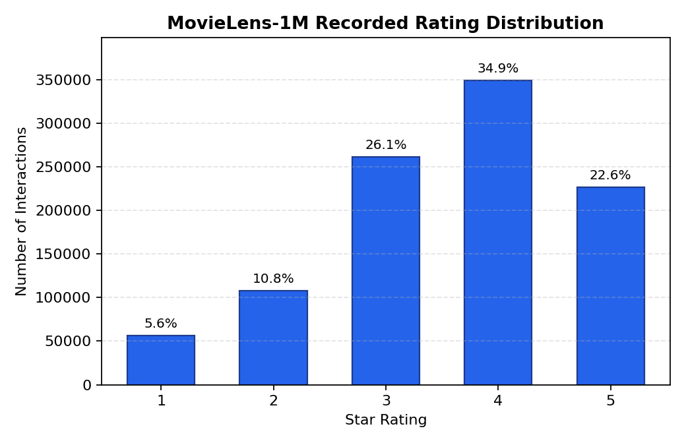
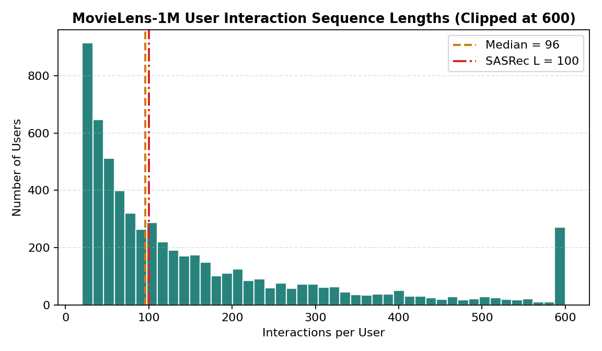
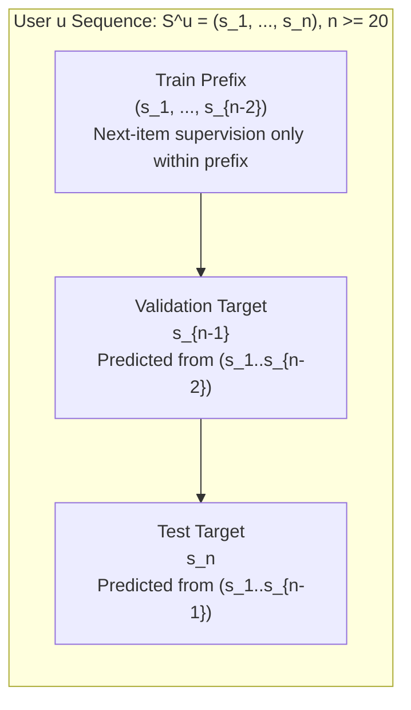

# 1. Problem Formulation and Dataset Analysis

## 1.1. Sequential Recommendation Problem Formulation

In modern entertainment and e-commerce platforms, user preferences are dynamic rather than static, combining long-term tastes with short-term sequential intent within the most recent interactions. Classical collaborative filtering methods such as Matrix Factorization treat a user's history as an unordered set, discarding all temporal transition signals between items.

This project addresses **Next-Item Sequential Recommendation** on the **MovieLens-1M** benchmark (Harper & Konstan, 2015). Let $\mathcal{U} = \{1, 2, \dots, |\mathcal{U}|\}$ denote the set of valid users and $\mathcal{I} = \{1, 2, \dots, N\}$ denote the catalog of rated movies, where item ID `0` is strictly reserved as the padding token ($0 \notin \mathcal{I}$). For each user $u \in \mathcal{U}$, ordering interactions chronologically by timestamp produces a user sequence:

$$S^u = \left(s_1^u, s_2^u, \dots, s_{n_u}^u\right), \quad s_t^u \in \mathcal{I}, \quad n_u \ge 5$$

Given a valid history prefix $(s_1^u, \dots, s_m^u)$, a sequential recommendation model learns a scoring function $f_\theta\left(i \mid s_1^u, \dots, s_m^u\right) \in \mathbb{R}$ over the entire valid catalog $i \in \mathcal{I}$. Unseen candidate items are ranked by their raw model scores to return a Top-$K$ list ($K = 10$) predicting the next recorded interaction $s_{m+1}^u$.

### Methodological Caveat on Rating Timestamps
A common but inaccurate assumption is equating MovieLens timestamps with verified movie watch times. In MovieLens-1M, the `Timestamp` field records **when a user submitted a rating on the MovieLens web interface**, **not** the verified time at which the movie was watched.

Our data quality audit on MovieLens-1M directly confirms this batch-rating behavior: **6,038 out of 6,040 users (99.97%)** have at least two ratings sharing the exact same second-level Unix timestamp, accounting for **529,046 tied-timestamp transitions** out of `1,000,209` interactions (caused by users rating multiple previously watched movies in a single web session). Consequently, the task is rigorously formulated as **next-recorded-rating prediction**, and a deterministic tie-breaking policy is mandatory to guarantee reproducibility across all models.

---

## 1.2. Data Quality Audit and Measured MovieLens-1M Statistics

The preprocessing pipeline (`src/prepare_data.py`) parses `ratings.dat` (`UserID::MovieID::Rating::Timestamp`) and `movies.dat` (`MovieID::Title::Genres`, ISO-8859-1 / `latin-1` encoding), verifies referential integrity, deduplicates repeated `(user, movie)` pairs if present, applies deterministic chronological sorting, and retains users with at least $n_u \ge 5$ valid interactions. Table 1.1 summarizes the exact measured statistics produced by the pipeline (`mapping_version = ml1m_v1_d3f0ba385b14083d`).

**Table 1.1: Measured MovieLens-1M Data Quality and Preprocessing Statistics**

| Metric | Measured Value | Technical Notes |
| --- | ---: | --- |
| Raw rating records (`ratings.dat`) | 1,000,209 | Format: `UserID::MovieID::Rating::Timestamp` |
| Dropped missing-movie or duplicate `(u, i)` rows | 0 | 100% of ratings match `movies.dat` and are unique per `(u, i)` |
| Retained valid users ($|\mathcal{U}|$, threshold $n_u \ge 5$) | 6,040 | Dropped short users: `0` (minimum sequence length is 20) |
| Total movies in raw catalog (`movies.dat`) | 3,883 | Parsed with release year and pipe-delimited genres |
| Rated movies retained ($N = |\mathcal{I}|$) | 3,706 | Mapped contiguously to `1..3706`; `0` reserved for padding |
| Unrated catalog movies excluded | 177 | Removed from candidate space `1..N` |
| Interaction matrix density | 4.4684% | Matrix sparsity: **95.5316%** |
| Users with tied timestamps | 6,038 (99.97%) | 529,046 tied-timestamp transitions |
| Deterministic tie-breaking rule | Fixed | Sorted by `(timestamp, raw_movie_id, original_line_index)` |

Excluding the 177 unrated movies and mapping the 3,706 rated movies contiguously to `1..3706` ensures that the item embedding matrix $\mathbf{M} \in \mathbb{R}^{(N+1) \times d}$ contains no dead embedding rows that never receive gradients during training, while keeping `pad_id = 0` strictly isolated.

---

## 1.3. Rating Distribution and Sequence Length Analysis

### Rating Distribution
Following standard sequential recommendation practice (Kang & McAuley, 2018; Hidasi et al., 2016), every recorded rating event in `ratings.dat` is treated as an implicit interaction signal indicating user engagement with that movie, while star ratings are preserved for exploratory analysis.

**Table 1.2: Star Rating Distribution in MovieLens-1M**

| Star Rating | Interaction Count | Share (%) |
| :---: | ---: | ---: |
| 1 star | 56,174 | 5.62% |
| 2 stars | 107,557 | 10.75% |
| 3 stars | 261,197 | 26.11% |
| 4 stars | 348,971 | 34.89% |
| 5 stars | 226,310 | 22.63% |

The distribution exhibits clear **selection/positivity bias**: **83.63%** of all recorded ratings are 3 stars or higher, with 4-star ratings alone representing **34.89%**. Users naturally self-select movies they expect to enjoy.

### User Sequence Length Distribution and Choice of $L = 100$

**Table 1.3: User Sequence Length Quantiles ($n_u$) in MovieLens-1M**

| Statistic | Min | 25th Percentile (P25) | Median | Mean | 75th Percentile (P75) | 90th Percentile (P90) | Max |
| --- | ---: | ---: | ---: | ---: | ---: | ---: | ---: |
| Sequence length $n_u$ | 20 | 44 | 96.0 | 165.60 | 208 | 400 | 2,314 |

The user length distribution is heavy right-tailed:
- Every user has at least $n_u = 20$ interactions, meaning after holding out 2 targets for Validation and Test, the **Train prefix always contains at least 18 valid interactions per user** (distinguishing short-history users from true zero-history cold-start users).
- The median user length is **96 interactions**, closely matching our default maximum sequence length **$L = 100$**: specifically, **3,131 users (51.84%)** have $n_u \le 100$ (kept in full with right-padding `0`), while **2,909 users (48.16%)** have $n_u > 100$ (truncated to their most recent $L = 100$ items). Setting $L = 100$ balances historical context coverage against the $O(L^2)$ self-attention memory footprint on our local RTX 4060 (8 GB VRAM).

---

## 1.4. Chronological Leave-One-Out Split and Full-Catalog Evaluation Protocol

To enforce temporal causality and prevent any future leakage, each chronologically ordered user sequence $S^u = (s_1^u, \dots, s_{n_u}^u)$ is partitioned via **Leave-One-Out**:

1. **Train Split**: Prefix $(s_1^u, \dots, s_{n_u-2}^u)$. All next-item supervision targets and Most-Popular item counts are derived strictly from this prefix; neither $s_{n_u-1}^u$ nor $s_{n_u}^u$ is ever exposed during training.
2. **Validation Split**: Predict $s_{n_u-1}^u$ given history $(s_1^u, \dots, s_{n_u-2}^u)$. Used for hyperparameter selection and saving the best model checkpoint by `NDCG@10`.
3. **Test Split**: Predict $s_{n_u}^u$ given history $(s_1^u, \dots, s_{n_u-1}^u)$. Evaluated **exactly once** after final model selection; models are never tuned on test scores.

### Full-Catalog Ranking Protocol
Rather than relying on sampled evaluation (e.g., 1 positive + 100 random negatives), which has been shown to distort relative model rankings due to popularity bias (Krichene & Rendle, 2020), this project uses **full-catalog ranking** as the primary evaluation protocol:
- The candidate pool for user $u$ consists of all $N = 3,706$ valid catalog items (`1..3706`), excluding `pad_id = 0` and excluding items already seen in the input history, **while explicitly retaining the held-out target item** in the rankable pool.
- Exact score ties are broken deterministically by ascending `item_id` (`stable` sort).
- Both primary metrics at $K = 10$ are averaged across all $|\mathcal{U}| = 6,040$ users:

$$\text{HR}@10 = \frac{1}{|\mathcal{U}|} \sum_{u \in \mathcal{U}} \mathbb{I}\left(\text{rank}_u \le 10\right), \qquad \text{NDCG}@10 = \frac{1}{|\mathcal{U}|} \sum_{u \in \mathcal{U}} \frac{\mathbb{I}\left(\text{rank}_u \le 10\right)}{\log_2\left(\text{rank}_u + 1\right)}$$

where $\text{rank}_u \ge 1$ is the 1-indexed rank of user $u$'s held-out target item among valid candidates. `HR@10` measures Top-10 recall, while `NDCG@10` awards a logarithmically discounted gain that rewards placing the target item closer to rank 1.
