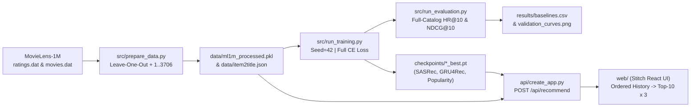
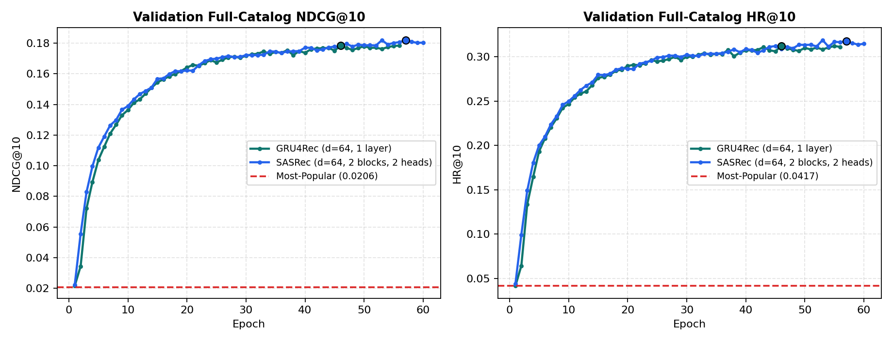
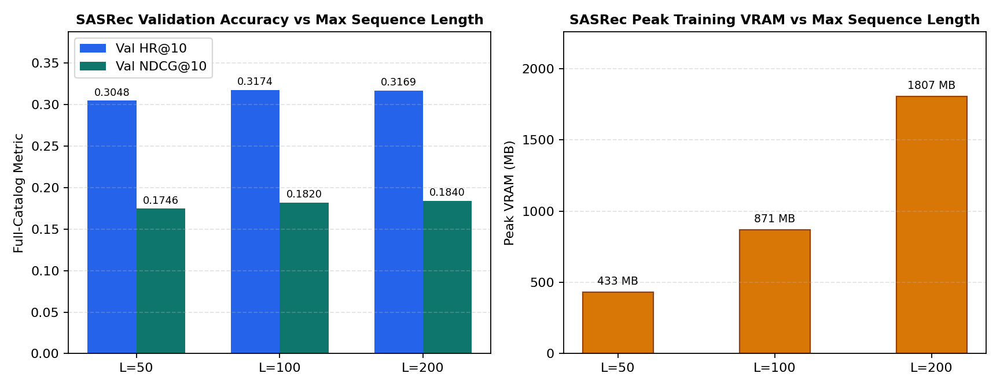
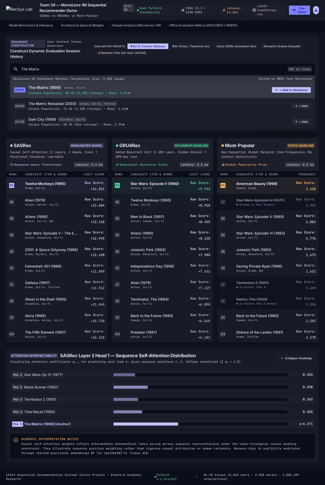

# 4. System Implementation

This section documents the software architecture, tensor shape flow, automated mask and metric verification gates, measured RTX 4060 training and VRAM characteristics, checkpoint serialization format, and the FastAPI + Stitch React serving contract.

---

## 4.1. Modular Architecture and Single-Responsibility Pipeline

To keep data preprocessing, modeling, training, evaluation, and API serving strictly decoupled between teammates, all Python code under `src/` and `api/` follows a **one-responsibility-per-file** architecture: each single-job module exposes exactly one public function matching its filename (e.g., `load_ratings`, `build_sasrec`, `mask_seen_items`) with zero cross-imports between single-job files. Thin orchestrators (`src/prepare_data.py`, `src/run_training.py`, `src/run_evaluation.py`, `src/run_ablation.py`, `api/create_app.py`) wire single-job modules sequentially without embedding processing logic.

---

## 4.2. Tensor Shapes and Model Footprint

Table 4.1 traces tensor dimensions through a single training mini-batch ($B = 128$, $L = 100$, $d = 64$, $h = 2$ heads, $b = 2$ blocks, vocabulary size $N + 1 = 3,707$).

**Table 4.1: Tensor Dimensions Across Training and Full-Catalog Evaluation**

| Stage | Tensor | Shape | Dtype | Notes |
| --- | --- | --- | --- | --- |
| Right-padded inputs & targets | `input_ids`, `target_ids` | `[128, 100]` | `int64` | `0` = right padding; `1..3706` = valid items |
| Valid mask | `valid_mask` | `[128, 100]` | `bool` | `True` where `input_ids != 0` |
| Combined embeddings (SASRec) | `x` | `[128, 100, 64]` | `float32` | $\sqrt{d}\,\mathbf{E}_{x_t} + \mathbf{P}_t$, zeroed on pad |
| Multi-head Q, K, V projections | `q`, `k`, `v` | `[128, 2, 100, 32]` | `float32` | $d_h = 64 / 2 = 32$ per head |
| Causal + key-padding attention | `attn_weights` | `[128, 2, 100, 100]` | `float32` | Strictly `0.0` for $j > i$ and padded keys/queries |
| Training full-catalog logits | `logits` (`all_positions=True`) | `[128, 100, 3707]` | `float32` | Column `0` suppressed to `-1e9`; `ignore_index=0` |
| Eval last-valid logits (`score_split`) | `last_logits` (`all_positions=False`) | `[256, 3707]` | `float32` | Read strictly at last valid index $t^\star(\mathbf{x})$ |

With weight tying between the input item embedding table and catalog scoring projection, both neural models remain compact and comparable in capacity:
- **GRU4Rec** ($d=64, 1\text{ layer}$): **262,336** trainable parameters (`237,248` item embedding + `25,088` GRU & LayerNorm).
- **SASRec** ($d=64, 2\text{ blocks}, 2\text{ heads}, L=100$): **294,208** trainable parameters (`237,248` item embedding + `6,400` positional embedding + `50,560` Transformer blocks & final LayerNorm).

---

## 4.3. Automated Verification Gates (`pytest`)

Before training on MovieLens-1M, all mandatory contract invariants in `CONTRACT.md` §7 are enforced by `14` automated unit tests across `tests/` (`pytest -v`, **14 passed in 8.27 s**):
1. **Data & Leave-One-Out Integrity (`test_data_pipeline.py`)**: Verifies deterministic `(timestamp, raw_movie_id, line_index)` tie-breaking, exclusion of unrated movies, contiguous `1..N` indexing without `0`, and zero leakage of `val`/`test` targets into `train`.
2. **Full-Catalog Evaluation (`test_evaluation_metrics.py`)**: Matches exact hand-computed `HR@10` and `NDCG@10`, ensures `pad_id=0` and seen history items are masked to $-\infty$ while explicitly keeping the held-out target rankable, and checks deterministic ascending-`item_id` tie-breaking.
3. **SASRec & GRU4Rec Mask/Padding Safety (`test_sasrec_masks.py`, `test_baselines_and_training.py`)**:
   - Finite loss and finite non-NaN gradients on short right-padded batches (`item_emb.weight[0]` and its gradient stay strictly `0.0`).
   - **Zero future token leakage**: Perturbing any future token $t' > t$ produces `0.0` difference at all earlier positions $0 \dots t$.
   - **Right-padding invariance**: Adding arbitrary trailing `0` tokens leaves valid hidden states, valid attention weights, and last-valid logits identical within `atol=1e-6`, with strictly `0.0` attention weight placed on padded keys.
   - **Last valid state & reproducibility**: Rejects all-padding sequences (`ValueError`), matches `all_positions=False` exactly against `all_positions=True` at `length - 1`, and reproduces identical loss and score tensors across repeated runs with `seed=42`.
4. **API Contract (`test_mock_api.py`)**: Validates CORS preflight, `GET /api/movies` search, HTTP `422` rejection for empty/`0`/out-of-catalog histories, and full `POST /api/recommend` response schema compliance.

---

## 4.4. Training Configuration and Measured RTX 4060 Runtime & VRAM

All experiments ran locally on an **NVIDIA GeForce RTX 4060 Laptop GPU (8,188 MiB VRAM)** using Python 3.10.11 and PyTorch `2.14.1+cu130` (`seed = 42`). Both neural models used the **Adam** optimizer (`lr = 1e-3`, `weight_decay = 1e-5`), gradient norm clipping (`max_norm = 1.0`), `batch_size = 128`, `max_epochs = 60`, and early stopping (`patience = 10`) selecting the best checkpoint strictly by **Validation full-catalog `NDCG@10`**.

Because full-catalog FP32 next-item cross-entropy over `[128, 100, 3707]` required under **0.9 GB** of peak PyTorch VRAM (well within the 8 GB RTX 4060 budget), neither negative-sampling approximation nor chunked loss splitting was needed—preserving exact full-catalog supervision across all models.

**Table 4.2: Measured Training Cost, VRAM, and Validation/Test Summary on RTX 4060 (`seed = 42`)**

| Model | Params | Best Epoch (Run) | Train Time | Test Eval Time | Peak PyTorch VRAM | Val HR@10 | Val NDCG@10 | Test HR@10 | Test NDCG@10 |
| --- | ---: | :---: | ---: | ---: | ---: | ---: | ---: | ---: | ---: |
| **Most-Popular** | — | — | 5.51 s | 0.677 s | 0.00 MB | 0.041722 | 0.020605 | 0.035265 | 0.017324 |
| **GRU4Rec** ($L=100$) | 262,336 | 46 (56) | 49.60 s | 0.687 s | 780.44 MB | 0.312086 | 0.178495 | 0.276821 | 0.164375 |
| **SASRec** ($L=100$) | 294,208 | 57 (60) | 66.01 s | 0.772 s | 871.76 MB | **0.317384** | **0.182050** | **0.290397** | **0.168205** |

### Sequence-Length Memory & Compute Scaling (Ablation on Validation)
To verify how SASRec scales under full-catalog cross-entropy on the 8 GB RTX 4060, we additionally measured `L in {50, 100, 200}` (`results/ablation_seq_len.csv`, `seed = 42`):
- **$L = 50$**: `42.94 s`, `433.07 MB` peak VRAM, `Val HR@10 = 0.304801`, `Val NDCG@10 = 0.174580` (best epoch 56).
- **$L = 100$**: `71.74 s`, `870.68 MB` peak VRAM, `Val HR@10 = 0.317384`, `Val NDCG@10 = 0.182050` (best epoch 57 — exact bit-level reproduction of the MVP run).
- **$L = 200$**: `149.56 s`, `1,806.85 MB` peak VRAM, `Val HR@10 = 0.316887`, `Val NDCG@10 = 0.184022` (best epoch 59).

---

## 4.5. Checkpoint Reproducibility and FastAPI + Stitch React Serving

Every saved checkpoint (`checkpoints/popularity_best.pt`, `checkpoints/gru4rec_best.pt`, `checkpoints/sasrec_best.pt`) packages `model_state_dict`, `model_type`, exact `config`, `seed`, `num_items = 3706`, `mapping_version = ml1m_v1_d3f0ba385b14083d`, and `val_metrics`. At startup, FastAPI (`api/create_app.py` calling `api/load_models.py`) validates `mapping_version` and `num_items` across all three checkpoints against `data/item2title.json` before serving:
- `GET /api/health`: Reports live inference mode (`"real"`), catalog size (`3,706`), verified `mapping_version`, and inference device (`"cpu"`).
- `GET /api/movies?q=...&limit=...`: Case-insensitive lookup over all 3,706 real MovieLens-1M catalog titles.
- `POST /api/recommend`: Accepts `{"history_ids": [...], "top_k": 10}` and returns ordered `sasrec_recommendations`, `gru4rec_recommendations`, and `popular_recommendations` (excluding seen items and `0`) with **raw model scores** (labeled explicitly as `Raw Logit` / `Raw Count`, never as probabilities) plus SASRec sequence-level `attention` diagnostics (`layer=1, head=0`).

### Stitch React Frontend & Measured Local Inference Latency
The interactive dashboard under `web/` (`web/src/App.jsx` and single-responsibility components `HeaderBar`, `SearchMoviesPanel`, `SequenceTrack`, `RecommendationColumn`, `AttentionPanel`) was designed with Google Stitch (*Sequential RecSys Benchmark Studio*; Stitch is UI-only and performs zero AI inference) and compiled via Vite (`npm run build` in `617 ms`) into `web/dist/`, which FastAPI serves directly at `http://127.0.0.1:8000/`.

End-to-end local latency measured across `n = 30` sequential `POST /api/recommend` requests (input history lengths from `4` to `100`, running real SASRec + GRU4Rec + Most-Popular checkpoints plus attention extraction on CPU):
- **Mean latency**: `11.72 ms`
- **Median (P50)**: `11.38 ms`
- **P95**: `14.57 ms`
- **Max**: `18.07 ms`
