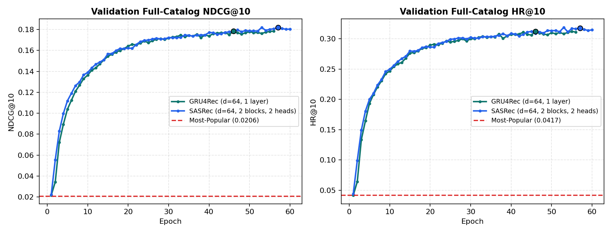
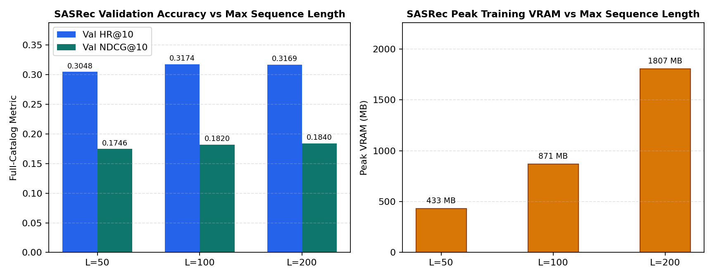
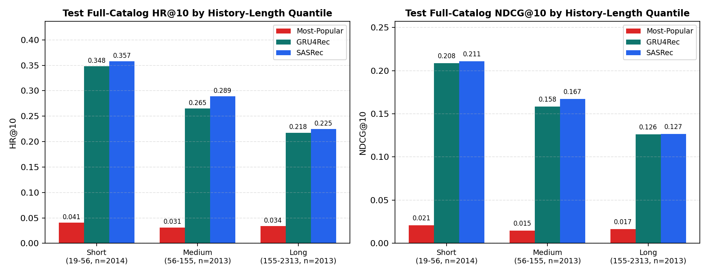
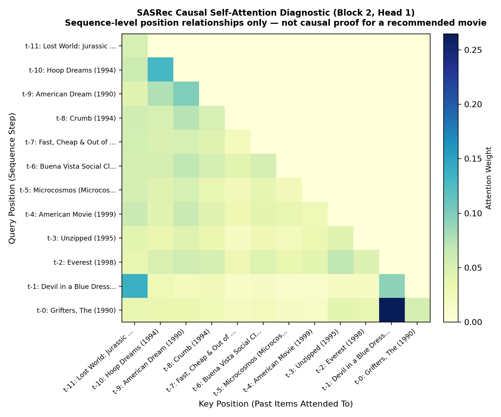

# 5. Evaluation and Error Analysis

This section presents the controlled empirical evaluation of **Most-Popular**, **GRU4Rec**, and **SASRec** under the shared MovieLens-1M Leave-One-Out full-catalog ranking protocol ($|\mathcal{U}| = 6,040$, $N = 3,706$, `seed = 42`). All conclusions are grounded strictly in measured results, including cases where SASRec underperforms GRU4Rec or fails alongside all baselines.

---

## 5.1. Overall Full-Catalog Ranking Performance

All three models were evaluated on the exact same user set, item-ID mapping (`mapping_version = ml1m_v1_d3f0ba385b14083d`), and candidate filtering rules (excluding `pad_id = 0` and seen history items while keeping the held-out target item rankable, with deterministic ascending-`item_id` tie-breaking). Checkpoints were selected strictly by **Validation `NDCG@10`**, and the held-out **Test** split was evaluated **once** after final model selection (`results/baselines.csv`).

**Table 5.1: Full-Catalog Leave-One-Out Evaluation Across All 6,040 MovieLens-1M Users (`seed = 42`)**

| Model | Architecture Summary | Best Epoch | Val HR@10 | Val NDCG@10 | Test HR@10 | Test NDCG@10 | Relative Test Gain vs. GRU4Rec |
| --- | --- | :---: | ---: | ---: | ---: | ---: | :---: |
| **Most-Popular** | Global frequency on Train only | — | `0.041722` | `0.020605` | `0.035265` | `0.017324` | `-87.3%` HR / `-89.5%` NDCG |
| **GRU4Rec** | 1-layer GRU, $d=64$, $L=100$ | 46 | `0.312086` | `0.178495` | `0.276821` | `0.164375` | Baseline |
| **SASRec** | 2 blocks, 2 heads, $d=64$, $L=100$ | 57 | **`0.317384`** | **`0.182050`** | **`0.290397`** | **`0.168205`** | **`+4.90%` HR / `+2.33%` NDCG** |

### Key Empirical Findings
1. **Sequential Modeling Dominates Global Popularity**: Both neural sequential models achieve roughly **8x higher `HR@10`** and **9.5x higher `NDCG@10`** than **Most-Popular** (`0.2768–0.2904` vs. `0.0353` on Test `HR@10`). Because MovieLens-1M users average 165.6 interactions and have already seen many global blockbusters, non-personalized popularity ranking rapidly loses discriminative power once seen movies are masked out.
2. **SASRec vs. GRU4Rec**: On the full catalog, **SASRec** outperforms **GRU4Rec** on both Validation (`+0.0053 HR@10`, `+0.0036 NDCG@10`) and held-out Test (`+0.0136 HR@10`, `+0.0038 NDCG@10`), confirming that causal multi-head self-attention captures richer sequential patterns than a single-layer GRU at comparable parameter count (`294K` vs. `262K` parameters). Notably, the margin is modest rather than overwhelming—highlighting that a properly masked, full-cross-entropy GRU4Rec remains a very competitive baseline on dense datasets.
3. **Validation-to-Test Generalization Gap**: Both neural models show a consistent drop of ~0.027–0.035 in `HR@10` and ~0.014 in `NDCG@10` from Validation (`s_{n-1}`) to Test (`s_n`). This is expected under chronological Leave-One-Out because Test targets occur strictly later in calendar time (incorporating newer year-2000 releases and longer histories), and checkpoints are intentionally never tuned on Test.

---

## 5.2. Validation Learning Curves

Figure 5.1 traces epoch-by-epoch Validation `NDCG@10` and `HR@10` (`results/training_curves.csv`) for GRU4Rec and SASRec against the static Most-Popular reference line.

- **Early Convergence Speed**: Both GRU4Rec and SASRec surpass Most-Popular within Epoch 1 and climb steeply during Epochs 1–20 under full-catalog cross-entropy.
- **Late-Epoch Stability**: GRU4Rec peaks earlier at **Epoch 46** (`Val NDCG@10 = 0.1785`) and triggers early stopping (`patience = 10`) at Epoch 56 as validation metrics plateau. SASRec continues improving gradually through **Epoch 57** (`Val NDCG@10 = 0.1821`), suggesting that its 2-block residual self-attention architecture absorbs finer sequential co-occurrence signals slightly longer without destabilizing.

---

## 5.3. Post-MVP Sequence-Length Ablation ($L \in \{50, 100, 200\}$)

After locking the MVP checkpoints, we conducted a controlled validation-only ablation over maximum sequence length $L \in \{50, 100, 200\}$ (`results/ablation_seq_len.csv`, `seed = 42`) to evaluate the accuracy-versus-memory trade-off of SASRec's $O(L^2)$ attention mechanism on our RTX 4060 (8 GB VRAM).

**Table 5.2: SASRec Validation Performance and RTX 4060 Cost Across Max Sequence Lengths**

| Max Length $L$ | Best Epoch | Val HR@10 | Val NDCG@10 | Train Time (RTX 4060) | Peak PyTorch VRAM |
| :---: | :---: | ---: | ---: | ---: | ---: |
| `50` | 56 | `0.304801` | `0.174580` | `42.94 s` | `433.07 MB` |
| `100` (MVP Default) | 57 | **`0.317384`** | `0.182050` | `71.74 s` | `870.68 MB` |
| `200` | 59 | `0.316887` | **`0.184022`** | `149.56 s` | `1,806.85 MB` |

- Increasing context from $L = 50 \to 100$ produces a clear improvement (`+0.0126 HR@10`, `+0.0075 NDCG@10`), aligning with MovieLens-1M's median user length of `96`.
- Doubling context again from $L = 100 \to 200$ yields diminishing accuracy returns (`+0.0020 NDCG@10`, `-0.0005 HR@10`) while more than doubling both wall-clock training time (`71.7 s -> 149.6 s`) and peak VRAM (`870.7 MB -> 1,806.9 MB`). Thus, $L = 100$ represents the practical Pareto sweet spot for local RTX 4060 execution.

---

## 5.4. Cohort Analysis by User History-Length Quantiles

To assess how sequence length affects ranking behavior, all 6,040 test users were partitioned into three equal-sized tertiles (`Short`, `Medium`, `Long` — **2,013 to 2,014 users per cohort**, ensuring strong statistical stability per group; `results/length_quantiles.csv`).

> **Important Distinction (Short History vs. True Cold-Start):** Even users in our `Short` cohort have between **19 and 56 prior interactions** before predicting their test target. MovieLens-1M therefore does **not** evaluate true zero-history cold-start users (`0` interactions); conclusions for the `Short` cohort apply strictly to shorter observed histories, not cold-start onboarding.

**Table 5.3: Held-Out Test Full-Catalog Performance Across User History-Length Tertiles**

| Cohort (Test History Length) | Users ($n$) | Median Len | Model | Test HR@10 | Test NDCG@10 | Median Rank | Mean Rank |
| --- | ---: | ---: | --- | ---: | ---: | ---: | ---: |
| **Short** (`19–56`) | 2,014 | 33.0 | Most-Popular | `0.040715` | `0.020774` | 358.0 | 622.36 |
| **Short** (`19–56`) | 2,014 | 33.0 | GRU4Rec | `0.348064` | `0.208494` | 27.0 | 172.78 |
| **Short** (`19–56`) | 2,014 | 33.0 | **SASRec** | **`0.357498`** | **`0.210596`** | **23.0** | **164.42** |
| **Medium** (`56–155`) | 2,013 | 95.0 | Most-Popular | `0.031297` | `0.014621` | 435.0 | 685.92 |
| **Medium** (`56–155`) | 2,013 | 95.0 | GRU4Rec | `0.264779` | `0.158349` | 42.0 | 239.16 |
| **Medium** (`56–155`) | 2,013 | 95.0 | **SASRec** | **`0.289121`** | **`0.167217`** | **37.0** | **215.01** |
| **Long** (`155–2313`) | 2,013 | 292.0 | Most-Popular | `0.033780` | `0.016576` | 521.0 | 742.36 |
| **Long** (`155–2313`) | 2,013 | 292.0 | GRU4Rec | `0.217586` | `0.126260` | 82.0 | 344.61 |
| **Long** (`155–2313`) | 2,013 | 292.0 | **SASRec** | **`0.224540`** | **`0.126780`** | **70.0** | **298.10** |

### Cohort Insights
1. **Why Accuracy Decreases with User History Length**: Counterintuitively at first glance, all three models achieve their **highest `HR@10`/`NDCG@10` on Short histories** (`SASRec HR@10 = 0.3575`) and their **lowest on Long histories** (`SASRec HR@10 = 0.2245`). Two dataset mechanics explain this cleanly:
   - Heavy raters (`Long`, median `292` seen movies) have already rated and masked out hundreds of mainstream titles, so their final held-out rating $s_n$ is disproportionately drawn from rarer long-tail movies with weaker collaborative signals.
   - Histories exceeding $L = 100$ lose their oldest interactions due to window truncation.
2. **Where Self-Attention Adds the Most Value**: SASRec delivers its largest accuracy lead over GRU4Rec in the **Medium** cohort (`56–155` items, median `95`, almost perfectly matching $L = 100$): **`+0.0243 HR@10`** (`+9.2%` relative) and **`+0.0089 NDCG@10`**. On **Long** histories (`155–2313`), SASRec also sharply lowers tail ranking errors compared to GRU4Rec (`Mean Rank 298.10` vs. `344.61`; `Median Rank 70.0` vs. `82.0`), reflecting direct $O(1)$ access across the 100-item window without recurrent state decay.

---

## 5.5. Concrete Error Analysis (Three Held-Out Test Cases)

To move beyond aggregate metrics, we inspected three diverse failure modes directly extracted from held-out Test predictions (`results/error_cases.json`).

### Error Case 1 — SASRec Miss Where GRU4Rec Succeeds (`User #2435`, History Length = `116`)
- **Recent 5 History Movies**: *Ferris Bueller's Day Off (1986)* (`Comedy`), *Stand by Me (1986)* (`Adventure|Comedy|Drama`), *Back to the Future (1985)* (`Comedy|Sci-Fi`), *There's Something About Mary (1998)* (`Comedy`), and *Blazing Saddles (1974)* (`Comedy|Western`).
- **Held-Out Target**: ***The Naked Gun: From the Files of Police Squad! (1988)*** (`Comedy`, train frequency `677`).
- **Model Ranks & Predictions**:
  - **GRU4Rec — Rank `#2` (Hit)**: Top-3 = *Bull Durham (1988)* (`7.2411`), ***The Naked Gun (1988)*** (`6.9509`), *Airplane! (1980)* (`6.9119`).
  - **SASRec — Rank `#30` (Miss)**: Top-3 = *Groundhog Day (1993)* (`6.9195`), *Bull Durham (1988)* (`6.8895`), *The Breakfast Club (1985)* (`6.6536`).
  - **Most-Popular — Rank `#320` (Miss)**: Top-3 = *Jurassic Park (1993)*, *The Silence of the Lambs (1991)*, *Fargo (1996)*.
- **Evidence-Based Diagnosis**: Both sequential models correctly recognize the 1980s/1990s Comedy theme. However, the user's immediately preceding item was Mel Brooks' spoof *Blazing Saddles (1974)*, and GRU4Rec's recency-weighted recurrent gate tightly locked onto the **parody/slapstick sub-genre** (ranking *The Naked Gun* `#2` and *Airplane!* `#3`). SASRec spread weight across broader 1980s/1990s dramedies (*Stand by Me*, *Ferris Bueller*, *High Fidelity*) and ranked *The Naked Gun* outside the Top-10 (`#30`). This confirms that SASRec's broader historical aggregation can occasionally dilute sharp local transitions where GRU4Rec excels.

### Error Case 2 — Abrupt Genre Shift Missed by Both Sequential Models (`User #4064`, History Length = `1,008`)
- **Recent 5 History Movies**: *A Goofy Movie (1995)*, *My Dog Skip (1999)*, *Keeping the Faith (2000)*, *Wonder Boys (2000)*, and *The Whole Nine Yards (2000)* — an unbroken streak of 8 recent `Comedy / Family / Romance` titles from 1999–2000.
- **Held-Out Target**: ***U-571 (2000)*** (`Action|Thriller`, train frequency `879`) — **zero genre overlap** with the preceding 5 items.
- **Model Ranks & Predictions**: **SASRec = `#23`**, **GRU4Rec = `#31`**, **Most-Popular = `#51`**. Both SASRec (*Road Trip*, *Drowning Mona*, *Hanging Up*, *Next Friday*, *Small Time Crooks*) and GRU4Rec (*What Planet Are You From?*, *Drowning Mona*, *Road Trip*, *Deuce Bigalow*, *Next Friday*) coherently predicted other year-2000 comedies.
- **Evidence-Based Diagnosis**: Neither model failed conceptually—both captured the exact release year (`2000`) and dominant comedy cluster. The miss stems from an **unpredictable cross-genre pivot** likely driven by MovieLens's batch web rating workflow (Section 1.1): users often rate several comedies in a row before switching to a newly released 2000 Action/Thriller title.

### Error Case 3 — Long-History Truncation & Long-Tail Sparsity Missed by All Models (`User #4647`, History Length = `892`)
- **Recent 5 History Movies**: *Indecent Proposal (1993)* (`Drama`), *Guinevere (1999)* (`Drama|Romance`), *Besieged (1998)* (`Drama`), *Cape Fear (1962)* (`Film-Noir|Thriller`), *Corrina, Corrina (1994)* (`Comedy|Drama|Romance`).
- **Held-Out Target**: ***Sunset Strip (2000)*** (`Comedy`, **only `5` total occurrences in the Train split**).
- **Model Ranks**: **SASRec = `#1,636`**, **GRU4Rec = `#2,306`**, **Most-Popular = `#2,520`**.
- **Evidence-Based Diagnosis**: With only 5 training interactions across all 6,040 users, pure ID-based models (without side metadata such as release year, cast, or synopsis) receive almost no gradient updates to position *Sunset Strip (2000)* accurately in embedding space. Combined with truncating `892` historical items to $L = 100$ and heterogeneous cinephile tastes spanning 1946–1999, all three models rank this rare tail movie past rank `1,600`.

---

## 5.6. Optional Sequence-Level Attention Diagnostic

To inspect how trained SASRec blocks distribute weight across historical positions, we extracted Block 2, Head 1 causal self-attention weights for **Test User #171** (`results/attention_sample.json`), whose 23-item history ends with two neo-noir crime films—*Devil in a Blue Dress (1995)* and *The Grifters (1990)*—and whose held-out target ***L.A. Confidential (1997)*** (`Crime|Film-Noir|Mystery|Thriller`) was predicted by SASRec at **Rank `#1`**.

At the last valid query position (`t = 23`: *The Grifters*), Block 2, Head 1 assigns its single largest attention weight (**`0.2646`**) to position `t = 22` (*Devil in a Blue Dress*, sharing exact `Crime|Film-Noir|Mystery|Thriller` genres), with smaller secondary weights distributed over earlier dramas/crime classics (*The Godfather* `0.0515`, *The Spanish Prisoner* `0.0507`) and minimal weight on unrelated comedies (*Airplane!* `0.0081`).

> **Strict Interpretation Caveat:** Attention weights are an internal diagnostic describing token-to-token mixing within one selected layer and head; because representations pass through multiple heads, residual paths, LayerNorm, and non-linear FFNs before catalog scoring, high attention weight on a movie is **not** causal proof that it alone caused the `#1` recommendation.
